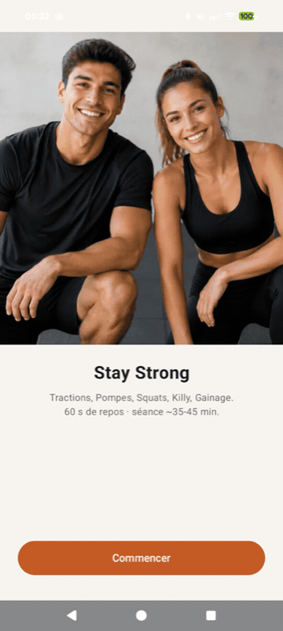

# Stay Strong

[English](README.md) · Français

App Android **hors ligne** : circuit au poids de corps, niveaux, agenda.

[](LICENSE)

## Présentation

Application Android **hors ligne** pour un circuit au poids de corps :

**Tractions → Pompes → Squats → Killy → Gainage**

Programmes par niveaux, chrono de repos, saisie des séries max, séance complète, agenda avec historique, articles, export/import.

<p align="center">
  
</p>

<p align="center">
  <em>Aperçu : démarrage → entraînement → niveaux → séance → agenda → articles</em>
</p>

## Fonctionnalités

- Circuit fixe au poids de corps
- Niveaux de progression
- Chrono de repos
- Suivi des séries / max
- Agenda et historique
- Articles
- Export / import des données
- Fonctionnement 100 % hors ligne

## Stack

- Kotlin
- Jetpack Compose
- Android (hors ligne d'abord)

## Build

```bash
# Android Studio, ou
./gradlew assembleDebug
```

## Licence

[Apache License 2.0](LICENSE)
