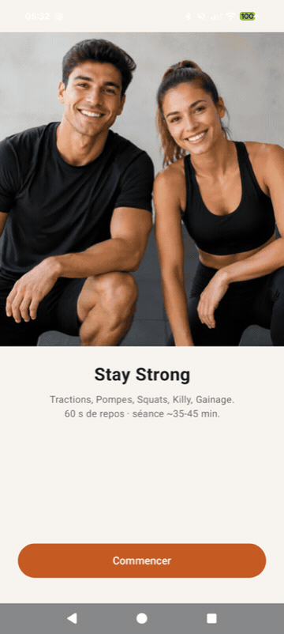

# Stay Strong

[Français](#français) · [English](#english)

App Android **offline** : circuit poids de corps, niveaux, agenda.

**Offline** Android bodyweight training app: circuits, levels, agenda.

[](LICENSE)

---

## Français

### Présentation

Application Android **hors ligne** pour un circuit au poids de corps :

**Tractions → Pompes → Squats → Killy → Gainage**

Programmes par niveaux, chrono de repos, saisie des séries max, séance complète, agenda avec historique, articles, export/import.

<p align="center">
  
</p>

<p align="center">
  <em>Aperçu : démarrage → entraînement → niveaux → séance → agenda → articles</em>
</p>

### Fonctionnalités

- Circuit fixe au poids de corps
- Niveaux de progression
- Chrono de repos
- Suivi des séries / max
- Agenda et historique
- Articles
- Export / import des données
- Fonctionnement 100 % offline

### Stack

- Kotlin
- Jetpack Compose
- Android (offline first)

### Build

```bash
# Android Studio, ou
./gradlew assembleDebug
```

### Licence

[Apache License 2.0](LICENSE)

---

## English

### Overview

**Offline** Android app for a bodyweight circuit:

**Pull-ups → Push-ups → Squats → Wall sit → Plank**

Level-based programs, rest timer, max sets logging, full session flow, agenda with history, articles, export/import.

<p align="center">
  
</p>

<p align="center">
  <em>Preview: start → training → levels → session → agenda → articles</em>
</p>

### Features

- Fixed bodyweight circuit
- Progression levels
- Rest timer
- Sets / max tracking
- Agenda and history
- Articles
- Data export / import
- Fully offline

### Stack

- Kotlin
- Jetpack Compose
- Android (offline first)

### Build

```bash
# Android Studio, or
./gradlew assembleDebug
```

### License

[Apache License 2.0](LICENSE)
