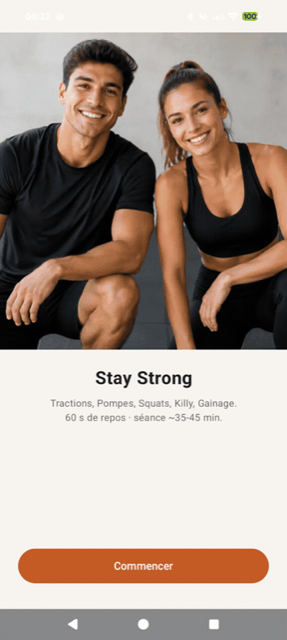

# Stay Strong

English · [Français](README.fr.md)

**Offline** Android bodyweight training app: circuits, levels, agenda.

[](LICENSE)

## Overview

**Offline** Android app for a bodyweight circuit:

**Pull-ups → Push-ups → Squats → Wall sit → Plank**

Level-based programs, rest timer, max sets logging, full session flow, agenda with history, articles, export/import.

<p align="center">
  
</p>

<p align="center">
  <em>Preview: start → training → levels → session → agenda → articles</em>
</p>

## Features

- Fixed bodyweight circuit
- Progression levels
- Rest timer
- Sets / max tracking
- Agenda and history
- Articles
- Data export / import
- Fully offline

## Stack

- Kotlin
- Jetpack Compose
- Android (offline first)

## Build

```bash
# Android Studio, or
./gradlew assembleDebug
```

## License

[Apache License 2.0](LICENSE)
